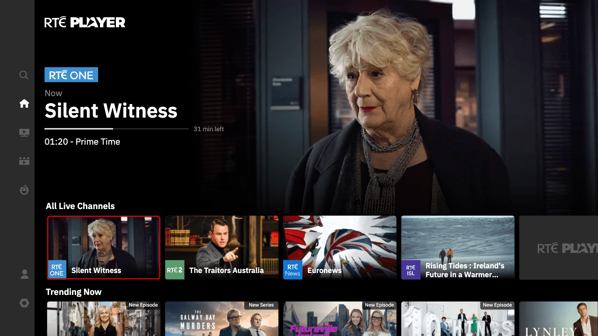

# RTÉ Player for older Samsung TVs

A patched RTÉ Player for Tizen 2.4, tested on a Samsung UE40K5500. Be patient with it, initial load times are *painfully* slow.



Download the unsigned WGT from [Releases](../../releases). The prebuilt app files are in `tv-app`. This is release **1.0**, based on RTÉ frontend **0.170.54075_2**.

## Sign-in helper

RTÉ rejects sign-in requests sent directly from the packaged app with `Origin: null`. A private Cloudflare Worker forwards the login POST and returns the response to the TV.

1. In Cloudflare’s **Workers & Pages**, create a Worker and deploy the starter app.
2. Open **Edit code**, replace the starter code with `worker/index.mjs`, and deploy.
3. Under **Settings → Variables and Secrets**, add a secret called `SECRET_KEY`. Use a random value of at least 32 characters, such as one generated by a password manager.
4. Save and deploy, then copy the Worker’s HTTPS URL.

Use your own Worker and key. The Worker forwards the app’s `deviceId` unchanged. Login responses pass through Cloudflare over HTTPS.

The supplied `wrangler.example.json` disables Worker observability. You can turn this off in the dashboard too.

[Cloudflare setup](https://developers.cloudflare.com/workers/get-started/dashboard/) · [Adding secrets](https://developers.cloudflare.com/workers/configuration/secrets/)

## Install

You’ll need Tizen Studio with the Samsung TV and certificate extensions, and developer mode enabled on the TV.

1. Import the release WGT as a Tizen web project using the packaged-application import option.
2. Edit `login-helper-config.js` with your Worker URL and the same key you saved in Cloudflare.

    ```javascript
    window.__rteLoginHelper = {
        url: "https://YOUR-WORKER.workers.dev",
        key: "YOUR-SECRET-KEY"
    };
    ```

3. Create or select your Samsung TV profile in Certificate Manager. The distributor certificate must include your TV’s DUID.
4. Select the profile and choose **Build Signed Package**.
5. Connect the TV in Device Manager, select it as the target, then choose **Run As → Tizen Web Application**.
6. Open **Sign In** in the app and enter the pairing code at https://www.rte.ie/connect.

Keep your configured project and signed WGT private because they contain your helper key. If you change the key in Cloudflare, update the app’s config and sign and install it again.

**Clear storage** resets the app’s saved data. You can then pair it again through Sign In.

## Updates

The RTÉ frontend is bundled with the app. New website releases won’t replace those files, but changes to RTÉ’s APIs, DRM or external SDKs can still break things.

The patching tools and original frontend files are in `maintenance`. See the [maintenance README](maintenance/README.md) for rebuilding and updating them.
